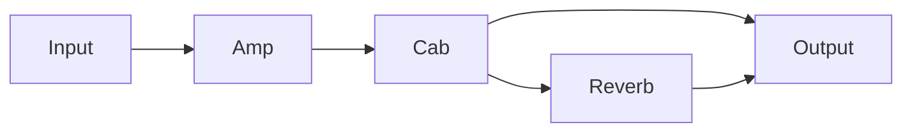

# General editing and connected routing design

Status: [live controls and bounded observation](live-tools.md) and [automatic isolated placement](automatic-placement.md) extend the implementation. Release 0.17.0 implements the shared planner, saved-image writers, complete-image executor, CLI/MCP reviews, connected grid and special-path reports, compound Scene MIDI editing and receipt-based undo/reconciliation. See [implemented contracts and coverage](preset-editing.md). Direct per-parameter editor commands are replaced by deterministic complete-image upload with full readback using the contained restore path. This enables supported saved editing without guessing command encodings. The design below remains the expansion specification for wider field calibration, modifier/Scene Ignore semantics, configured MIDI routing and global I/O configuration; those extensions do not disable current operations.

Add one deterministic edit planner in `Fractal.Core`, with typed operations for parameters, scene names, scene block state and routing. Reuse the existing transport, backups, guarded commands, persistence and recovery machinery. CLI and MCP expose the same plans. FM9, FM3 and Axe-Fx III use common contracts with independently qualified model/firmware profiles.

## Scope and outcomes

| Feature | Intended behavior |
| --- | --- |
| Amp and Cab editing | Read and set supported parameters on an explicit block instance and channel; resolve type and cabinet selections through the target catalogue. |
| Effect editing | Use the same parameter contract for supported effect families, including type-dependent values, units and enumerations. |
| Scene names | Rename explicitly selected scenes, preserving every other name, scene setting and the saved default scene. |
| Bypass and channel control | Set absolute live state, or edit persistent per-scene assignments, with these intents distinguished in the request. |
| Connected insertion | Insert an exact instance at caller-selected placement and replace explicitly selected connections with the reviewed path. |
| Connected removal | Remove an exact instance using an explicit disconnect, replace-with-shunt or reconnect policy. |
| Routing edits | Connect/disconnect existing endpoints and form explicit splits and merges within qualified grid rules. |

The first implementation handles one preset per plan. Cross-preset batches, automatic placement, moving existing blocks, arbitrary feedback/Send/Return paths, modifier editing, IR installation, cross-model conversion and a graphical editor remain separate extensions. Existing modifier/controller assignments must still be detected and preserved. General editing grows by qualified parameter coverage; it does not expose arbitrary parameter numbers as a fallback.

## Current implementation and gaps

| Foundation | Reuse | Required extension |
| --- | --- | --- |
| [DeviceDefinition](../src/Fractal.Core/DeviceDefinition.cs) | Model identity, capacity, grid and transfer bounds | Versioned operation, parameter, scene-state and routing profiles; no FM9 catalogue fallback |
| [PresetBody](../src/Fractal.Core/PresetBody.cs), [SnapshotExport](../src/Fractal.Core/SnapshotExport.cs) | Complete captures, raw grid words, Amp model/channel/scene projection, names, opaque records | General block identity-to-record mapping, semantic parameters and a lossless routing graph |
| [EditorCommand](../src/Fractal.Core/EditorCommand.cs), [ReadSession](../src/Fractal.Core/ReadSession.cs) | Typed commands, closed scopes, serialized transport and status reads | Closed parameter/name/state/connection operations and correlated semantic reads |
| [BlockInsertionSession](../src/Fractal.Core/BlockInsertionSession.cs), [BlockRemovalSession](../src/Fractal.Core/BlockRemovalSession.cs) | Exact instance/cell validation and existing isolated behavior | Reusable mutation steps that can participate in one larger transaction without independently saving |
| [EditorPreservation](../src/Fractal.Core/EditorPreservation.cs) | Independent whole-image preservation checks | Exact field/bit ownership and structural comparisons for combined changes |
| [SceneMidiEditSession](../src/Fractal.Core/SceneMidiEditSession.cs), [SceneMidiRecovery](../src/Fractal.Core/SceneMidiRecovery.cs) | Verification sequence, durable attempt records, later-edit refusal | Operation-specific edit receipts and reconciliation while retaining old record compatibility |
| [PresetRestore](../src/Fractal.Core/PresetRestore.cs) | Target-specific complete backup restoration | Reuse for explicit exact-result undo; no new upload format |
| [MCP adapter](mcp.md) | Frozen reviews, trusted-host approval, attempt inspection | Typed catalogue/planning/preparation entry points calling the core |

`GridCell.RouteFlag` is currently retained as a raw word. The removal planner conservatively refuses a nonzero local flag or routing in the preceding column; it does not decode an edge graph. `EditorCommand.SetSceneMidiField` accepts only Scene MIDI fields. Its float envelope is not a general parameter contract. The Amp projection currently identifies records partly by shape; new editing must establish exact instance identity rather than infer it from column counts or ordering.

The [published Axe-Fx III MIDI specification, revision 1.4](https://www.fractalaudio.com/downloads/misc/Axe-Fx%20III%20MIDI%20for%203rd%20Party%20Devices.pdf), checked 11 October 2026, documents absolute bypass/channel set/get commands (0A/0B), scene selection (0C), scene-name queries (0E) and block status (13). It supplies a starting point for Axe-Fx III live control, not scene-name writes, audio parameter writes, connected routing or FM9/FM3 compatibility. Private editor evidence starts with the pinned symbols in [editing-pilot.md](editing-pilot.md) and the [reference map](../knowledge-base/reference-map.md). Unknown encodings remain explicit implementation blockers.

## Shared request and plan contract

Proposed names below are new APIs, not commands available today.

`PresetEditRequest` contains a schema version, explicit device context, zero-based preset slot, immutable saved baseline reference and hash, persistence mode, and typed operations. Device context includes model, established capacity, recorded firmware and selected profile versions. The public boundary uses scenes 1–8, one-based grid cells and supported channel labels. Wire conversions belong in profiles.

Use a closed operation union:

| Operation | Required intent |
| --- | --- |
| `SetParameter` | Exact instance, channel or declared global scope, semantic key, typed value and unit |
| `SetBlockType` | Exact instance/channel, qualified type identity and explicit reset policy |
| `RenameScene` | Scene number and exact replacement text |
| `SetSceneBlockState` | Exact instance, explicit scene set, optional absolute bypass and/or channel value |
| `InsertBlock` | Exact absent instance, chosen empty cell and initialization policy |
| `RemoveBlock` | Exact instance and removal policy with explicit replacement connections where needed |
| `Connect` / `Disconnect` | Exact source/destination endpoints; edge preconditions derived from the baseline |
| `InsertShunt` / `RemoveShunt` | Exact cell and explicit route changes |

Convenience requests such as `InsertOnConnection` expand into these operations before review. They reference a particular baseline edge, not an inferred notion of “after the amp.” Removing a block does not imply deleting its entire signal branch.

`PresetEditPlan` freezes the request, baseline wire/raw/body hashes, protocol release, profile/catalogue hashes, resolved instance identities, exact before/after values, changed cells/edges, dependency order and verification requirements. It includes the complete permitted write footprint and expected intermediate states. An unresolved field, unknown relevant route bit or ambiguous identity prevents an executable plan. A draft may retain unresolved facts without gaining execution authority.

The planner returns per-operation `planned`, `unchanged`, `conflict` or `unsupported`, with stable reason codes and actionable details. Conflicting assignments to the same field or edge are errors, not last-write-wins. Preconditions come from the retained baseline and are independently checked by the runtime. A plan with any blocking item is not partially executed.

Canonical ordering and serialization produce identical plan hashes for equivalent resolved requests. A fresh plan against an already matching result produces no writes or Save. Reusing an old executed review is refused; idempotent planning is distinct from replaying an execution.

## Parameter catalogues and semantic reads

Introduce `ParameterCatalogue` and `DeviceEditProfile` under the core, with attributed data in `knowledge-base/catalog`. Keep semantic names common while resolving numeric IDs, saved locations and editor encodings independently for each model/firmware and block type.

Each descriptor records:

- Stable semantic key, display label/aliases, family, applicable type and channel/global scope.
- Value type, unit, exact enum identities, range, resolution, wire encoding and saved representation. These representations need not match.
- Read strategy and independent verification strategy; comparison uses declared quantization, never a general floating-point tolerance.
- Dependencies, tempo synchronization, modifier/controller ownership, type/reset effects and qualified initialization defaults.
- Source identifier, revision/hash, locator, firmware applicability and separate read/write/physical qualification.

Reject non-finite values, ambiguous aliases, unsupported units, out-of-range values and unknown enum identities. Report any proposed quantization in the review; do not silently clamp or substitute. Keep unknown numeric values and opaque data visible in reads.

Editing a channel parameter affects every scene using that channel. The preview must list those scenes. A request expressed as “change gain in this scene” cannot silently modify a shared channel or create/copy another channel. Resolve the intended channel scope before producing an executable plan.

For existing blocks, unspecified values remain exact. Changing type is a separate operation because it can reset other fields. A type change requires a qualified reset footprint, a reviewed final value/default policy for affected settings and readback of the reset before dependent writes. If the reset cannot be bounded, reject the compound edit. Preserve controller/modifier metadata; initially refuse writes whose effect is governed by an unresolved modifier, scene controller or linked setting.

Cabinet selection distinguishes factory identities from user asset references. A user IR slot alone is not content identity. Binding an existing slot can be explicitly reviewed as a slot selection with identity unverified; a request for a named or exact IR requires independent asset evidence and otherwise remains unresolved. IR transfer is not part of this feature.

Deliver a versioned coverage matrix by family, parameter, model and firmware. Start with Amp gain/tone/level, Cab existing selection/level/filter controls and a bounded Reverb or Delay parameter set, subject to actual mappings. These are semantic coverage targets, not asserted parameter IDs or hardware compatibility. Unsupported fields do not disable other supported edits or reads.

## Scene names and block state

Scene-name profiles define encoding, maximum byte length, padding and termination. Reject unrepresentable or oversized names before any mutation; never silently truncate. Verify the exact saved name and a correlated live query when available. Bracket scene-name reads with stable preset state because the reply omits preset identity. Preserve other names and default-scene bytes.

Distinguish three operation modes:

| Mode | State and persistence contract |
| --- | --- |
| `LiveBlockControl` | Separate small request against the currently loaded preset/scene; set absolute bypass/channel, read it back, never Save or navigate implicitly. |
| `PresetEditRequest` with `edit-buffer` | Apply a reviewed compound edit and verify the complete live image. Report `verified-live`; saved content must remain unchanged. |
| `PresetEditRequest` with `save` | Apply and verify the complete live result, Save once, verify repeated saved reads and Reload. Report `verified-saved` only after all checks pass. |

Live control captures the current loaded baseline and preserves existing unsaved edits outside the authorized state fields; require enough semantic coverage to prove this. Compound editing initially requires loaded/saved equality before navigation and mutation. Supporting arbitrary pre-existing unsaved changes in compound plans is a later extension. No mode implies permission to discard them.

`SetSceneBlockState` edits explicitly selected scene assignments. Validate actual channel count and block support. Treat Scene Ignore, global linking and controller ownership as dependencies; refuse an assignment whose requested behavior cannot be achieved while preserving them. Do not automatically turn these features off. Bypass state and bypass mode are distinct: changing the former must preserve the latter unless separately requested.

Avoid scene/channel navigation for editing where an addressed operation exists. If navigation is required, include its sequence, expected outgoing Scene MIDI effects and final selection in the review. Restore the original saved default scene before Save when required by the qualified save semantics. Restoring selection after Save must be verified separately and cannot hide an unsaved image change. A final selection different from the saved default needs an explicit supported selection contract; otherwise finish on the preserved default scene.

## Routing representation and policies

Add `RoutingGraph` with nodes for exact block instances, shunts and model-qualified I/O endpoints. Nodes retain their grid cells; edges identify source and destination endpoints. The graph is a semantic projection of the captured routing words, not a replacement for the raw evidence. Retain each word, known-bit mask and unknown bits so encoding a change cannot erase unfamiliar data.

`RoutingProfile` owns legal adjacency, row/column bounds, edge bit ownership/direction, endpoint constraints, fan-in/fan-out rules and shunt representation. Do not infer these from the existing isolation test or copy them between models. Require decode/encode round trips to preserve untouched bits exactly, plus independent expected-edge fixtures. Unknown bits in a word that an operation would modify block that operation; untouched opaque regions may remain if preservation is provable.

The implemented graph includes forward grid cables and the two fixed Send/Return pairs. It detects feedback components and requires explicit intent for newly introduced loop edges. Model-qualified I/O endpoints and saved scene bypass state produce conditional potential paths. Existing feedback permits ordinary editing; no loop level is changed implicitly. Global source settings, physical cables and unqualified USB identities remain explicit unknowns. Unknown bits in a changed routing word produce a localized conflict while unrelated opaque bytes remain preserved.

Connected insertion must identify the exact edge being replaced, a legal empty cell or explicitly targeted shunt, and the new instance. Retain other edges from the same source and into the same destination. Expand a longer path into explicit shunts only when the caller chose those cells or accepted a concrete proposed layout in the review. Do not move blocks to make space. Apply the shared placement validation; keep legacy isolated-plan behavior unchanged.

Removal requires one of these policies; there is no default:

| Policy | Graph transformation | Review requirement |
| --- | --- | --- |
| `disconnect` | Delete the block and exactly its incident edges | Show every interrupted path and newly disconnected endpoint |
| `replace-with-shunt` | Substitute a qualified shunt at the cell and preserve the intended connectivity | Prove the shunt can represent the same connections; disclose that processing disappears |
| `reconnect` | Delete the block and incident edges, then add caller-selected replacement edges or shunt paths | Explicit endpoints and legal cells for every replacement; reject ambiguity |

For a single predecessor/successor the planner can propose one reconnect path. For multiple inputs/outputs it must not form the Cartesian product automatically; that could mix previously separate signals. A pre-existing equivalent edge is deduplicated without changing its semantics. Never replace an occupied cell or another block instance implicitly.

Synthetic routing example, showing logical edges rather than device cell encodings:



Inserting a Delay on `Cab -> Reverb` replaces only that edge with `Cab -> Delay -> Reverb`. The direct `Cab -> Output` path stays unchanged. Removing Reverb with `disconnect` removes its two incident edges and retains the direct path. Reconnecting its input to Output would duplicate an existing logical edge, so the preview must show the resulting single edge and removed processing explicitly.

Validate final and intermediate graphs: occupied cells, duplicate instances, unsupported endpoints, dangling references, illegal adjacency, unsupported cycles, and model limits. Preview input/output reachability changes, splits and merges. Deliberately disconnected paths are allowed only as explicit intent. Connectivity does not establish gain, phase, bypass behavior or audible equivalence; structural verification and signal testing are separate claims.

## Combined execution and preservation

Use a proposed `PresetEditSession` to compose operation steps through `ReadSession`. Extract the minimum prepare/apply/verify boundaries from existing insertion/removal sessions; retain their existing wrappers and regression tests. Do not weaken their isolated guards to make connected editing pass. New closed scopes validate the exact resolved command and order, including parameter value, channel, scene, cell and endpoint.

The executor is a sequential transaction with verified checkpoints, not a claim that hardware supports atomic edits:

1. Validate all artifacts, profiles and the exact review offline; acquire the one coordinated device transport.
2. Verify device/firmware/capacity, selection, fresh saved baseline and loaded state. Refuse unexpected unsaved work or state drift before navigation. Capture the original complete images privately.
3. Persist an attempt checkpoint before each mutation. Execute each allowed step once, then verify the expected intermediate state before dependent writes.
4. Verify the complete final loaded image and all intended semantics. Independently compare all preserved content, including Scene MIDI, other channels/scenes, names, opaque regions and default scene.
5. For `edit-buffer`, finish with live verification and unchanged saved bytes. For `save`, recheck saved base and live result immediately before one Save; verify repeated saved reads and complete reloaded equality.
6. Retain result captures, per-step outcomes, verification evidence and a versioned receipt. Recheck the final selection contract. A lost reply or successful send is never a verified result.

Type selection and initialization precede dependent parameter writes. Routing order must be derived from qualified device side effects and permitted intermediate graphs: add/configure a node before connecting it; detach reviewed edges before deletion where supported. Do not promise click-free or uninterrupted audio. If a safe intermediate sequence cannot be established, refuse the plan. Never silently mute, alter output levels or toggle bypass as a transaction aid.

New block contents can retain previous instance settings, as recorded in [the editing pilot](editing-pilot.md). Therefore compound insertion requires a qualified initialization policy and a complete bounded expectation for the new record. Unknown defaults block the executable compound plan. Legacy isolated insertion remains available under its existing weaker initialization contract; a subsequent fresh capture can support a separate reviewed configuration/routing plan.

Preservation must work at field/bit granularity and structural record boundaries. A parameter write owns only its qualified field and declared reset dependencies; it does not grant permission to ignore the whole record. A routing write owns only reviewed bits. Insert/remove changes own exact instance intervals identified independently, while unchanged records remain byte-exact even if offsets move. Account separately for qualified derived compression/checksum changes. Existing raw-header/padding checks remain the baseline; broaden them only with evidence of a necessary representation change.

The independent verifier derives the permitted footprint from the immutable operation/profile definitions, not from a device diff or a caller-supplied mask. Saved and live semantic readers check requested values; independent fixtures/front-panel comparisons qualify those readers. Successful encode/decode using the same mistaken map is insufficient evidence.

## Failure and recovery

Extend the existing durable recovery pattern with a versioned operation kind; preserve existing Scene MIDI receipts and readers. Record original captures, attempt intent, last verified checkpoint, sent command identity and any verified result before reporting completion. Use the existing lease and atomic-file patterns.

On rejection, timeout, cancellation, failed preservation or disk failure, stop further mutation. In particular, a failed pre-Save check must prevent Save. Mark `stopped-uncertain` where the device outcome is unknown. Do not automatically replay a field, reconnect a route, Save, Reload or restore a backup.

Explicit recovery first compares fresh saved and loaded images against retained original/result/checkpoint evidence. An original match means no verified saved change; it does not clear a partial live edit. A result match can be independently verified without repeating mutations. A partial or foreign state requires a newly reviewed recovery action bound to those current bytes. Never resume based solely on a sent-command counter.

Exact-result undo restores the original full backup only while the current saved result and loaded state still match the receipt's allowed state. Later edits produce a conflict. Undo of an unsaved edit is a distinct live-buffer recovery operation and must not Save or discard other unsaved work. Selective merge and automatic rollback remain excluded.

## CLI and MCP integration

Proposed offline CLI operations are `edit-capabilities`, `edit-catalogue`, `plan-edit` and `inspect-edit-plan`. Planning and catalogue lookup open no MIDI ports. Expose explicitly opted-in execution only through the same core scopes and existing trusted review mechanism, including CLI callers; no generic shell or SysEx entry point is added.

Proposed MCP additions are `fractal_query_edit_capabilities`, `fractal_query_parameters`, `fractal_plan_preset_edit`, `fractal_prepare_preset_edit` and a separate `fractal_prepare_block_control`. Reuse `fractal_execute_review` and `fractal_inspect_attempt`. Both adapters return the same semantic diff, reasons, evidence limits and persistence status.

Reviews show parameter changes with units, affected shared-channel scenes, renamed scenes, absolute state changes, routing before/after, removed processing, initialization/reset effects, navigation effects and persistence. Bind the complete plan, device/connection context, source hashes and catalogue/protocol versions. Changed bindings invalidate approval. Honor existing exact user authorization through the trusted host as described in [mcp.md](mcp.md); model-controlled calls cannot approve themselves.

Use a new versioned edit snapshot/projection without rewriting existing immutable exports. Older Scene MIDI and isolated insertion/removal planners remain compatible with their existing schemas. New planners can decode retained captures into the new projection. Missing routing/parameter semantics in an old snapshot are unknown, never empty/default values.

## Delivery sequence and acceptance

| Milestone | Deliverable | Acceptance gate |
| --- | --- | --- |
| 1. Profiles and reads | Exact instance mapping; parameter/state/name/routing profiles; semantic projection; capability matrix | Independent fixtures for FM9, FM3 and Axe-Fx III at both capacities; unsupported profiles remain explicit; no device connection in offline work |
| 2. Scene editing and control | Scene rename, absolute live bypass/channel, persistent scene assignments | Encoding limits, Scene Ignore/dependencies, preservation, unsaved-work protection, default-scene checks and idempotent plans |
| 3. Parameter editing | Bounded Amp, Cab and effect coverage; types/reset policies; shared-channel previews | Unit/enum/quantization tests, type side effects, modifier refusal, IR identity limits and unchanged unrelated channels/fields |
| 4. Connected routing | Graph planner, connect/disconnect, shunts, connected insertion/removal policies | Series and parallel fixtures, ambiguous reconnect refusal, bit preservation, intermediate-state checks and repeat-run no-ops |
| 5. Composition and adapters | One reviewed compound transaction; durable receipts; CLI/MCP tools | One Save only after complete verification; relocated adapter tests; stale-review, cancellation, uncertain-write and exact undo coverage |
| 6. Physical qualification | Separately authorized edit/routing/save/reload/undo trials | Publish the actual model/firmware/parameter/family scope, independent semantic checks and signal-path results; retain failures |

Each milestone extends the common model paths from the outset. Missing physical hardware is reported separately from missing protocol implementation; a missing profile blocks its operation, not the whole device. Release only the supported-operation matrix, with experimental and physically qualified status separate.

Offline tests must include boundary strings, invalid inputs, missing/duplicate records, conflicting edits, non-finite values, enum mismatches, tempo-synced settings, channel sharing, all scenes, unknown route bits, fan-in/fan-out, duplicate edges, shunt limits, resource rejection, stale bases and preservation of Scene MIDI/opaque data. Failure injection must cover every mutating boundary, late device replies, Save uncertainty, cancellation, reconnect and recovery-state write failure. Unknown DSP costs remain unknown; a legal graph is not proof of available resources.

Run the required checks when implementation affects their layers:

```text
python -m unittest discover -s tests -v
python scripts/check_cli_pipeline.py
python scripts/check_mcp_pipeline.py
python scripts/validate_knowledge.py
python scripts/protocol_release.py
```

After reviewed protocol source changes, deliberately update the contained release manifest through its supported workflow, then verify it. Include complete sources, fixtures, licences, notices and hashes in each consumer release. Builds and normal runtime must not fetch protocol code or depend on PresetMaestro.

Physical acceptance covers an existing-parameter edit, scene rename/state change, connected series insertion, a parallel branch, each supported removal policy, Save/Reload, repeat-plan no-op and explicit original recovery. Compare independent device/editor values and actual signal paths where audio behavior is claimed; compare non-target saved inventories. Keep captures private and publish only neutral attributed fixtures or redacted qualification records. This design itself authorizes no hardware access.

## Protocol questions to close before execution

| Question | Required evidence |
| --- | --- |
| Parameter IDs, saved fields and wire scaling for each family | Pinned per-model catalogues plus independent expected values and qualified read/write trials |
| Type changes, linked controls and new-block initialization | Complete before/after images across channels; bounded reset/default profile |
| Scene-name write envelope and encoding | Retained source or trace, limits and saved/live/reload comparisons |
| Persistent scene state versus transient selection | Per-scene and Scene Ignore behavior, default-scene preservation and unsaved-image comparisons |
| Route direction, bit masks, legal adjacency and shunt identity | Independent graph/word fixtures, operation traces and physical structural/signal verification |
| Routing command granularity and intermediate effects | Qualified sequence for connect/disconnect/clear and rejection handling |

Resolve these from retained sources first, admitting new evidence with source revision, hash, date and model/firmware scope. Do not fill a protocol gap by borrowing another model's constants or by relaxing preservation checks.
